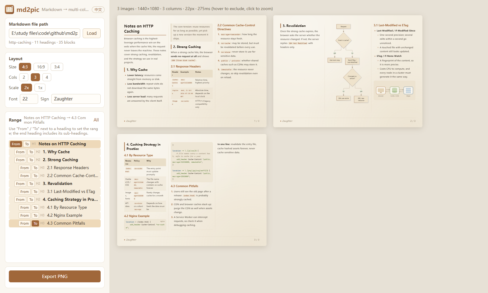
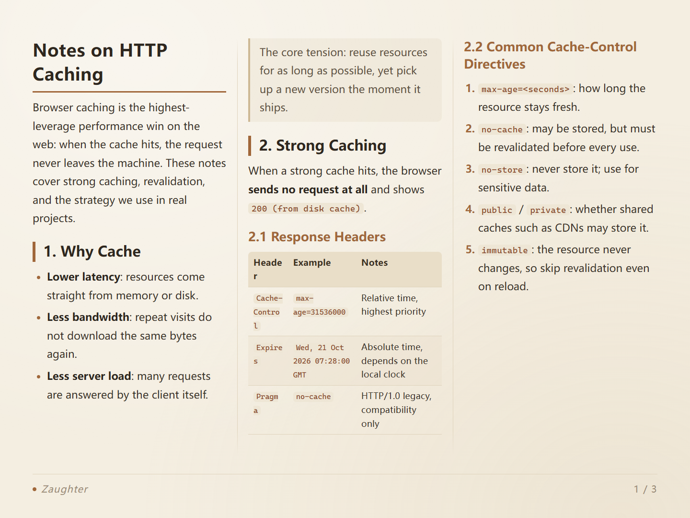
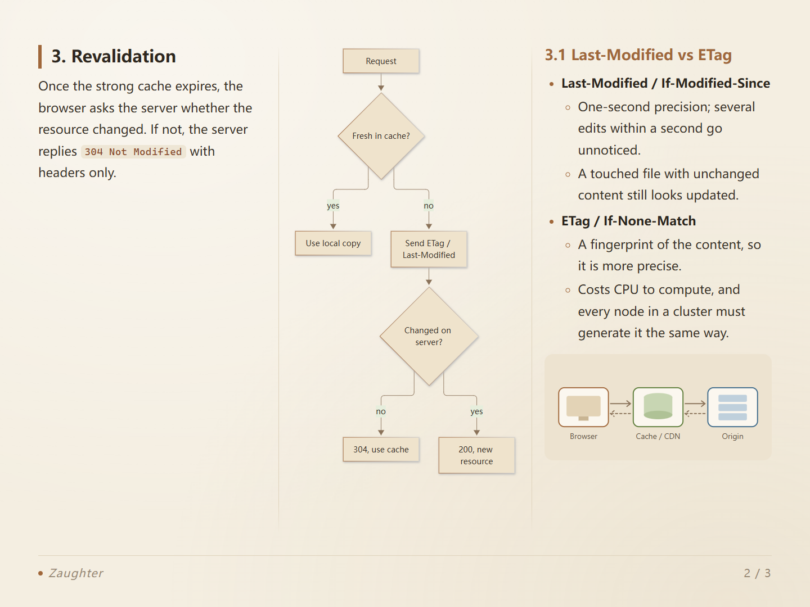
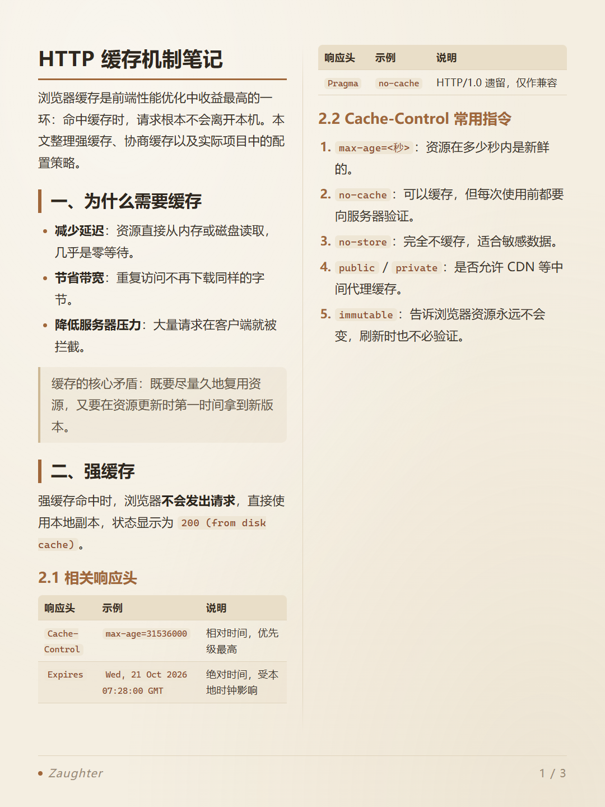

<div align="center">


# md2pic

**Turn Markdown notes into multi-column images, ready to post on social media.**

[](https://nodejs.org/)
[](https://github.com/markdown-it/markdown-it)
[](https://highlightjs.org/)
[](https://mermaid.js.org/)
[](https://playwright.dev/)
[](#requirements)
[](#language)

[简体中文](README.md) | English

</div>

---

Markdown notes are a single column. A screenshot of one fits little content and leaves wide empty margins. **md2pic** splits a note by its headings and lays it out on fixed-size pages with 2–4 columns. Every page uses the same font size, sections stay together where possible, and code, tables and Mermaid diagrams all render properly.

<p align="center">
  
</p>

## ✨ Features

- **Multi-column layout**: 2, 3 or 4 columns, flowing like a newspaper, with column dividers.
- **Several page sizes**: landscape 4:3 (1440×1080, default), wide 16:9 (1920×1080) and portrait 3:4 (1080×1440), with optional 2× export.
- **Heading-aware pagination**: a section stays on one page whenever it fits. Otherwise it breaks at a sub-heading, and only very long text is split to fill the page.
- **No wasted space**: leftover space at the bottom of a column is filled with the first part of the next list item, code block or table.
- **Elements stay intact**: code breaks only between lines; tables break only between rows and repeat their header; a heading is never left alone at the bottom of a column.
- **Narrow tables become cards**: a table with too many columns for its width is shown as cards, one card per row.
- **Full Markdown support**: syntax highlighting, tables, Mermaid diagrams, local and remote images, block quotes and task lists.
- **Pick a range**: choose start and end headings in the outline and export only that part.
- **Live preview**: changes re-layout instantly. Hover to exclude a page and click to zoom.
- **Remembers your session**: note path, range and layout settings are restored on the next launch.
- **Bilingual UI**: switch between Chinese and English with one click (Chinese by default).
- **No browser download**: export uses the Edge or Chrome already on your system instead of downloading Chromium.

## 🖼️ Gallery

> Rendered from [`example/http-caching.md`](example/http-caching.md): landscape 4:3, 3 columns, 22px.

<p align="center">
  
  
</p>

<details>
<summary>Portrait 3:4 · 2 columns</summary>
<p align="center"></p>
</details>

## 🚀 Quick Start

### Requirements

- [Node.js](https://nodejs.org/) 18 or later
- **Microsoft Edge** or **Google Chrome** installed (used for export; Windows 10/11 ships with Edge)

### Install and Run

```bash
git clone https://github.com/zaughterCoding/md2pic.git
```

```bash
cd md2pic
```

```bash
npm install
```

```bash
npm start
```

Your browser opens <http://localhost:3456> automatically. On Windows you can also double-click `start.bat` next time.

> The terminal window running the server is the app itself; keep it open while you work and close it to stop. If the server is already running, launching again just opens the existing page.

## 📖 Usage

1. **Load a note**: enter the full path of a local `.md` file at the top left and click **Load** (or press Enter).
2. **Choose a range**: in the **Range** outline, click **From** and **To** next to headings. The end heading includes all of its sub-headings. Click **All** to export the whole note.
3. **Adjust the layout**: pick the size, columns, scale, font size (8–40px) and signature. The preview updates live.
4. **Review**: hover a thumbnail to **Exclude** it; page numbers update automatically. Click a thumbnail to zoom in.
5. **Export**: click **Export PNG**. Images are saved to `<note name>_images/` next to the note, named like `01_Title.png`. Re-exporting first removes the previously exported images in that folder.

## 📐 Layout Rules

| Situation | Behavior |
|---|---|
| A section fits on the current page | It is placed as a whole |
| It doesn't fit, and the blank space left is at most one column | It starts on a new page, so the section stays intact |
| It doesn't fit, and more than one column would be left blank | It breaks at a sub-heading; the first part stays on the current page |
| Space remains at the bottom of a column | The first part of the next list item, code block or table fills it |
| A single element is taller than a whole column | It is split step by step: lists by inner blocks, then code and tables by lines/rows, then paragraphs by sentence |
| A table has too many columns for the width | It is rendered as cards |
| A page starts in the middle of a section | A "Section (cont.)" label is added at the top |

Plain paragraphs, images and Mermaid diagrams never span columns, and headings always stay with the content that follows.

## 🌐 Language

Click the **EN / 中文** button at the top left to switch the UI language (Chinese by default). The "continued" label on exported pages follows the language, and your choice is remembered.

## ⚙️ Configuration

All settings are stored in `config.json` at the project root. The file is created automatically and is ignored by Git.

| Field | Default | Description |
|---|---|---|
| `notePath` | — | Path of the last loaded note |
| `settings.pageSize` | `landscape` | `landscape` 4:3 / `wide` 16:9 / `portrait` 3:4 |
| `settings.columns` | `3` | Number of columns, 2–4 |
| `settings.fontSize` | `26` | Body font size in px, 8–40 |
| `settings.scale` | `2` | Export pixel ratio, 1 or 2 |
| `settings.signature` | `Zaughter` | Footer signature |
| `settings.lang` | `zh` | UI language, `zh` / `en` |
| `range` | `null` | Export range (start/end headings); `null` means the whole note |

Environment variables:

| Variable | Description |
|---|---|
| `PORT` | Server port, `3456` by default |
| `MD2PIC_CONFIG` | Path to a custom config file |
| `NO_OPEN` | Don't open the browser on start (same as `--no-open`) |

## 🗂️ Project Structure

```text
md2pic/
├── server.js          # Local server: parses Markdown, stores config, exports PNG via the browser
├── public/
│   ├── index.html     # UI
│   ├── app.js         # UI logic: outline, range, preview, export
│   ├── layout.js      # Layout engine: measuring, columns, pagination, splitting
│   ├── i18n.js        # Chinese / English strings
│   ├── page.css       # Page styles (palette, typography, syntax colors)
│   ├── app.css        # UI styles
│   └── logo.svg
├── example/           # Sample notes (zh / en)
├── docs/images/       # Images used by the README
└── start.bat          # Double-click launcher for Windows
```

## 🔧 How It Works

1. **Parse**: the server uses markdown-it to break the note into blocks: headings, paragraphs, list items, code, tables and Mermaid. Code is highlighted line by line with highlight.js. Lists and quotes also keep their inner blocks so they can be split when needed.
2. **Measure**: the browser renders every block in a hidden container exactly as wide as a column to get its precise height. Mermaid is rendered to SVG first.
3. **Lay out**: blocks are arranged into a tree by heading, and each section is placed according to the rules above.
4. **Export**: Playwright drives the system Edge or Chrome to run the same layout code and screenshot each page, so exports match the preview exactly.

## ❓ FAQ

<details>
<summary>Export fails because no browser is found</summary>

md2pic tries Microsoft Edge first and then Google Chrome. Make sure at least one of them is installed.
</details>

<details>
<summary>Port 3456 is already in use</summary>

Use another port with the `PORT` environment variable, e.g. `PORT=3457 npm start` (or `set PORT=3457 && npm start` on Windows).
</details>

<details>
<summary>Images in my note don't show up</summary>

Relative image paths are resolved from the note's folder, so check that the path is correct. Remote images must be reachable.
</details>

## 🙏 Acknowledgements

- [markdown-it](https://github.com/markdown-it/markdown-it): Markdown parsing
- [highlight.js](https://highlightjs.org/): syntax highlighting
- [Mermaid](https://mermaid.js.org/): diagrams
- [Playwright](https://playwright.dev/): browser automation
