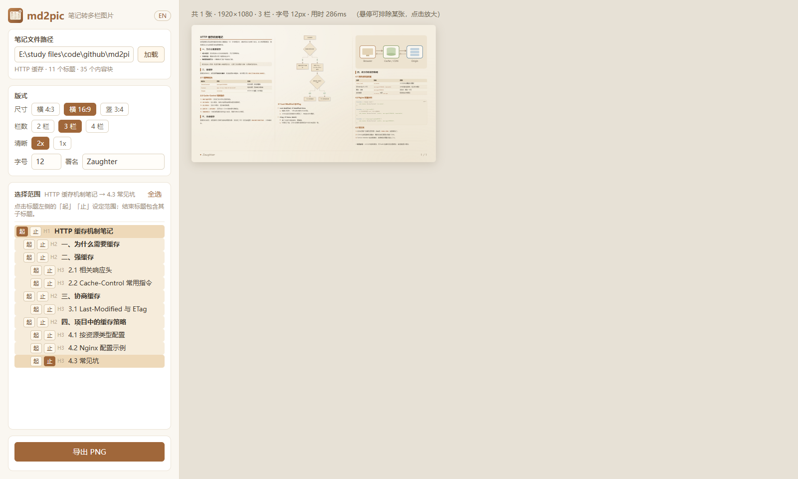
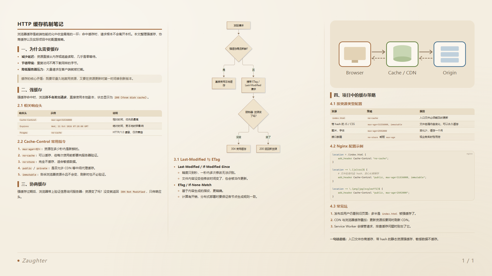
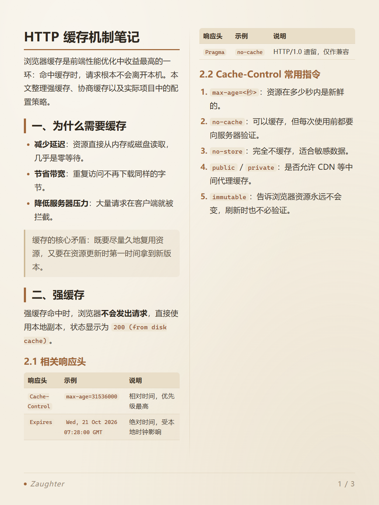

<div align="center">


# md2pic

**把 Markdown 笔记排成多栏图片，一键导出，适合发到小红书、朋友圈等社交平台。**

[](https://nodejs.org/)
[](https://github.com/markdown-it/markdown-it)
[](https://highlightjs.org/)
[](https://mermaid.js.org/)
[](https://playwright.dev/)
[](#环境要求)
[](#语言切换)
[](LICENSE)

简体中文 | [English](README.en.md)

</div>

---

Markdown 笔记是单栏的，直接截图发出去，一张图放不了多少内容，两侧还留着大片空白。**md2pic** 把笔记按标题自动切分，排成 2–4 栏的固定尺寸图片：同一张图里字号统一，章节尽量完整，代码、表格、Mermaid 图都能好好显示。

<p align="center">
  
</p>

## ✨ 特性

- **多栏排版**：支持 2 / 3 / 4 栏，报纸式从左到右排列，栏间有分隔线。
- **多种尺寸**：横 4:3（1440×1080，默认）、横 16:9（1920×1080）、竖 3:4（1080×1440），可导出 2 倍清晰度。
- **按标题智能分页**：同一标题下的内容尽量放在同一张图里；放不下时在子标题处断开；正文本身太长时再按填满切分。
- **不浪费空间**：栏底剩余的位置会被下一个列表项、代码块或表格的前半部分填上。
- **元素保持完整**：代码只在行间断开，表格只在行间断开且重复表头，标题不会孤零零留在栏底。
- **窄栏表格自动变卡片**：列数太多的表格会自动改为卡片式，每行一张卡片，不再挤成一团。
- **完整的 Markdown 支持**：代码高亮、表格、Mermaid 流程图、本地 / 网络图片、引用、任务列表。
- **选择导出范围**：在大纲里点选起止标题，只导出需要的部分。
- **实时预览**：调整设置立即重排；悬停可排除某张，点击可放大查看。
- **记住上次状态**：笔记路径、导出范围、版式设置都会保存，下次打开直接继续。
- **中英双语界面**：一键切换，默认中文。
- **无需下载浏览器**：直接调用系统已安装的 Edge / Chrome 截图，不额外下载 Chromium。

## 🖼️ 效果展示

> 以下图片由 [`example/HTTP 缓存.md`](example/HTTP%20缓存.md) 生成，设置为横 16:9、3 栏、12px。整篇笔记正好排进一张图。

<p align="center">
  
</p>

<details>
<summary>竖版 3:4 · 2 栏</summary>
<p align="center"></p>
</details>

## 🚀 快速开始

### 环境要求

- [Node.js](https://nodejs.org/) 18 及以上
- 系统已安装 **Microsoft Edge** 或 **Google Chrome**（用于导出图片，Windows 10/11 自带 Edge）

### 安装与运行

```bash
git clone https://github.com/zaughterCoding/md2pic.git
```

```bash
cd md2pic
```

```bash
npm install
```

```bash
npm start
```

启动后浏览器会自动打开 <http://localhost:3456>。Windows 用户之后也可以直接双击 `start.bat` 启动。

> 运行服务的终端窗口就是程序本身，使用期间不要关闭；关闭窗口即停止服务。如果服务已在运行，再次启动会直接打开已有页面。

## 📖 使用指南

1. **加载笔记**：在左上角输入本地 `.md` 文件的完整路径，点「加载」或回车。
2. **选择范围**：在「选择范围」大纲里点击标题左侧的「起」「止」。结束标题会包含它下面的所有子标题；点「全选」导出整篇。
3. **调整版式**：选择尺寸、栏数、清晰度、字号（8–40px）和署名，右侧会实时重排。
4. **检查预览**：把鼠标移到缩略图上可「排除」不需要的图片，页码会自动重排；点击缩略图可放大查看。
5. **导出**：点「导出 PNG」。图片保存在笔记同目录的 `笔记名_images/` 文件夹，命名为 `01_标题.png`。重新导出时会先清掉该文件夹里旧的导出图。

## 📐 排版规则

| 场景 | 处理方式 |
|---|---|
| 一个章节放得下当前图 | 整体放入 |
| 放不下，但当前图剩余空白不超过一栏 | 换到新的一张，保持章节完整 |
| 放不下，剩余空白超过一栏 | 在子标题处断开，前半部分留在当前图 |
| 栏底还有空位 | 用下一个列表项 / 代码 / 表格的前半部分填满 |
| 单个元素比一整栏还高 | 逐级拆分：列表按子块 → 代码 / 表格按行 → 段落按句子 |
| 表格列数相对栏宽太多 | 改为卡片式展示 |
| 新的一张从章节中间开始 | 顶部标注「章节名 · 续」 |

普通段落、图片和 Mermaid 图不会跨栏；标题始终和后面的内容放在一起。

## 🌐 语言切换

点击左上角的 **EN / 中文** 按钮切换界面语言，默认中文。导出图片里的「续」标记也会随语言变化，选择会被记住。

## ⚙️ 配置

所有设置都保存在项目根目录的 `config.json`（自动生成，已被 `.gitignore` 忽略）。

| 字段 | 默认值 | 说明 |
|---|---|---|
| `notePath` | — | 上次加载的笔记路径 |
| `settings.pageSize` | `landscape` | `landscape` 横 4:3 / `wide` 横 16:9 / `portrait` 竖 3:4 |
| `settings.columns` | `3` | 栏数，2–4 |
| `settings.fontSize` | `26` | 正文字号（px），8–40 |
| `settings.scale` | `2` | 导出倍率，1 或 2 |
| `settings.signature` | `Zaughter` | 页脚署名 |
| `settings.lang` | `zh` | 界面语言，`zh` / `en` |
| `range` | `null` | 导出范围（起止标题），`null` 表示全文 |

环境变量：

| 变量 | 说明 |
|---|---|
| `PORT` | 服务端口，默认 `3456` |
| `MD2PIC_CONFIG` | 自定义配置文件路径 |
| `NO_OPEN` | 设置后启动时不自动打开浏览器（也可用 `--no-open` 参数） |

## 🗂️ 项目结构

```text
md2pic/
├── server.js          # 本地服务：解析 Markdown、保存配置、调用浏览器导出 PNG
├── public/
│   ├── index.html     # 操作界面
│   ├── app.js         # 界面逻辑：大纲、范围选择、预览、导出
│   ├── layout.js      # 排版引擎：测量、分栏、分页、拆分
│   ├── i18n.js        # 中英文案
│   ├── page.css       # 图片页面样式（配色、排版、代码高亮）
│   ├── app.css        # 界面样式
│   └── logo.svg
├── example/           # 示例笔记（中 / 英）
├── docs/images/       # README 用图
└── start.bat          # Windows 双击启动
```

## 🔧 工作原理

1. **解析**：服务端用 markdown-it 把笔记拆成「内容块」，例如标题、段落、列表项、代码、表格和 Mermaid。代码用 highlight.js 逐行高亮；列表和引用还会记录内部子块，方便需要时拆开。
2. **测量**：浏览器在与成品等宽的隐藏容器里渲染每个块，得到精确高度。Mermaid 先渲染成 SVG。
3. **排版**：按标题建树，逐个章节尝试放入当前图。规则见上方「排版规则」。
4. **导出**：Playwright 驱动系统里的 Edge / Chrome，用同一份排版代码渲染，再逐张截图。所以导出结果和预览完全一致。

## ❓ 常见问题

<details>
<summary>导出时报错，找不到浏览器？</summary>

md2pic 依次尝试调用系统里的 Microsoft Edge 和 Google Chrome，请确认至少安装了其中一个。
</details>

<details>
<summary>端口 3456 被占用？</summary>

设置环境变量换一个端口，例如 Windows 下运行 `set PORT=3457 && npm start`。
</details>

<details>
<summary>笔记里的图片显示不出来？</summary>

相对路径的图片以笔记所在目录为基准解析，请确认路径正确。网络图片需要能正常访问。
</details>

## 🙏 致谢

- [markdown-it](https://github.com/markdown-it/markdown-it)：Markdown 解析
- [highlight.js](https://highlightjs.org/)：代码高亮
- [Mermaid](https://mermaid.js.org/)：图表渲染
- [Playwright](https://playwright.dev/)：浏览器截图

## 📄 许可证

本项目基于 [MIT License](LICENSE) 开源。
