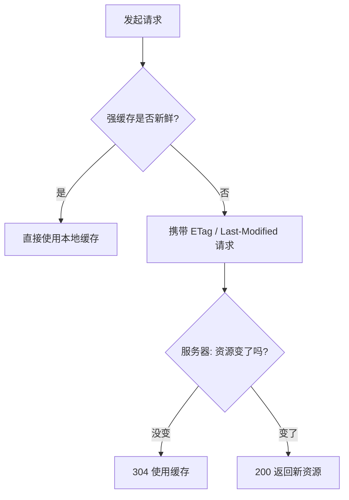
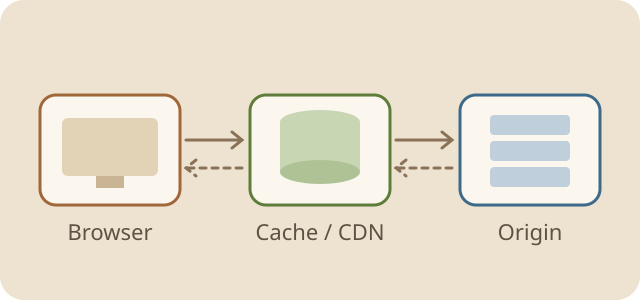

# HTTP 缓存机制笔记

浏览器缓存是前端性能优化中收益最高的一环：命中缓存时，请求根本不会离开本机。本文整理强缓存、协商缓存以及实际项目中的配置策略。

## 一、为什么需要缓存

- **减少延迟**：资源直接从内存或磁盘读取，几乎是零等待。
- **节省带宽**：重复访问不再下载同样的字节。
- **降低服务器压力**：大量请求在客户端就被拦截。

> 缓存的核心矛盾：既要尽量久地复用资源，又要在资源更新时第一时间拿到新版本。

## 二、强缓存

强缓存命中时，浏览器**不会发出请求**，直接使用本地副本，状态显示为 `200 (from disk cache)`。

### 2.1 相关响应头

| 响应头 | 示例 | 说明 |
|---|---|---|
| `Cache-Control` | `max-age=31536000` | 相对时间，优先级最高 |
| `Expires` | `Wed, 21 Oct 2026 07:28:00 GMT` | 绝对时间，受本地时钟影响 |
| `Pragma` | `no-cache` | HTTP/1.0 遗留，仅作兼容 |

### 2.2 Cache-Control 常用指令

1. `max-age=<秒>`：资源在多少秒内是新鲜的。
2. `no-cache`：可以缓存，但每次使用前都要向服务器验证。
3. `no-store`：完全不缓存，适合敏感数据。
4. `public` / `private`：是否允许 CDN 等中间代理缓存。
5. `immutable`：告诉浏览器资源永远不会变，刷新时也不必验证。

## 三、协商缓存

强缓存过期后，浏览器带上验证信息询问服务器：资源变了吗？没变就返回 `304 Not Modified`，只传响应头。



### 3.1 Last-Modified 与 ETag

- **Last-Modified / If-Modified-Since**
  - 精度只到秒，一秒内多次修改无法识别。
  - 文件内容没变但修改时间变了，也会被当作更新。
- **ETag / If-None-Match**
  - 基于内容生成的指纹，更精确。
  - 计算有开销，分布式部署时要保证各节点生成规则一致。



## 四、项目中的缓存策略

### 4.1 按资源类型配置

| 资源 | 策略 | 原因 |
|---|---|---|
| `index.html` | `no-cache` | 入口文件必须能及时更新 |
| 带 hash 的 JS / CSS | `max-age=31536000, immutable` | 文件名随内容变化，可以永久缓存 |
| 图片、字体 | `max-age=2592000` | 变化少，缓存一个月 |
| 接口数据 | `no-store` 或短 `max-age` | 视业务实时性而定 |

### 4.2 Nginx 配置示例

```nginx
location = /index.html {
    add_header Cache-Control "no-cache";
}

location ~* \.(js|css)$ {
    # 文件名带内容 hash，放心长期缓存
    add_header Cache-Control "public, max-age=31536000, immutable";
}

location ~* \.(png|jpg|svg|woff2)$ {
    add_header Cache-Control "public, max-age=2592000";
}
```

### 4.3 常见坑

1. 发布后用户仍看到旧页面：多半是 `index.html` 被强缓存了。
2. CDN 与浏览器缓存叠加：更新资源后要同时刷新 CDN。
3. Service Worker 会接管请求，排查缓存问题时别忘了它。

---

**一句话总结**：入口文件协商缓存，带 hash 的静态资源强缓存，敏感数据不缓存。
