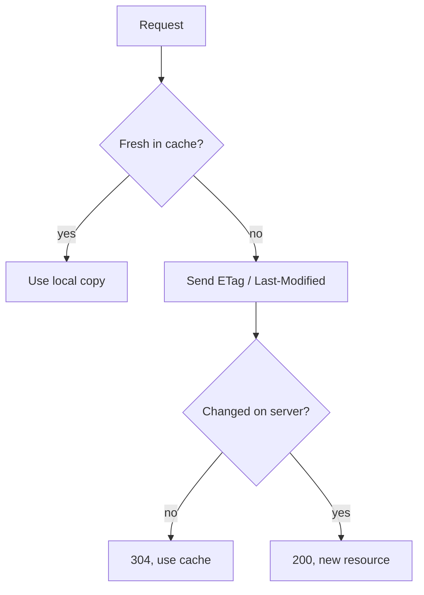
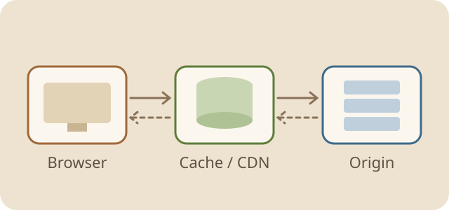

# Notes on HTTP Caching

Browser caching is the highest-leverage performance win on the web: when the cache hits, the request never leaves the machine. These notes cover strong caching, revalidation, and the strategy we use in real projects.

## 1. Why Cache

- **Lower latency**: resources come straight from memory or disk.
- **Less bandwidth**: repeat visits do not download the same bytes again.
- **Less server load**: many requests are answered by the client itself.

> The core tension: reuse resources for as long as possible, yet pick up a new version the moment it ships.

## 2. Strong Caching

When a strong cache hits, the browser **sends no request at all** and shows `200 (from disk cache)`.

### 2.1 Response Headers

| Header | Example | Notes |
|---|---|---|
| `Cache-Control` | `max-age=31536000` | Relative time, highest priority |
| `Expires` | `Wed, 21 Oct 2026 07:28:00 GMT` | Absolute time, depends on the local clock |
| `Pragma` | `no-cache` | HTTP/1.0 legacy, compatibility only |

### 2.2 Common Cache-Control Directives

1. `max-age=<seconds>`: how long the resource stays fresh.
2. `no-cache`: may be stored, but must be revalidated before every use.
3. `no-store`: never store it; use for sensitive data.
4. `public` / `private`: whether shared caches such as CDNs may store it.
5. `immutable`: the resource never changes, so skip revalidation even on reload.

## 3. Revalidation

Once the strong cache expires, the browser asks the server whether the resource changed. If not, the server replies `304 Not Modified` with headers only.



### 3.1 Last-Modified vs ETag

- **Last-Modified / If-Modified-Since**
  - One-second precision; several edits within a second go unnoticed.
  - A touched file with unchanged content still looks updated.
- **ETag / If-None-Match**
  - A fingerprint of the content, so it is more precise.
  - Costs CPU to compute, and every node in a cluster must generate it the same way.



## 4. Caching Strategy in Practice

### 4.1 By Resource Type

| Resource | Policy | Why |
|---|---|---|
| `index.html` | `no-cache` | The entry point must update promptly |
| Hashed JS / CSS | `max-age=31536000, immutable` | The file name changes with content, so cache forever |
| Images, fonts | `max-age=2592000` | Rarely change; cache for a month |
| API data | `no-store` or a short `max-age` | Depends on how fresh the data must be |

### 4.2 Nginx Example

```nginx
location = /index.html {
    add_header Cache-Control "no-cache";
}

location ~* \.(js|css)$ {
    # file names carry a content hash, safe to cache for a year
    add_header Cache-Control "public, max-age=31536000, immutable";
}

location ~* \.(png|jpg|svg|woff2)$ {
    add_header Cache-Control "public, max-age=2592000";
}
```

### 4.3 Common Pitfalls

1. Users still see the old page after a release: `index.html` is probably strongly cached.
2. CDN and browser caches stack up: purge the CDN as well when assets change.
3. A Service Worker can intercept requests, so check it when debugging caching.

---

**In one line**: revalidate the entry file, cache hashed assets forever, never cache sensitive data.
